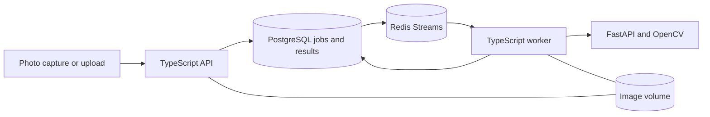

# CueVision

CueVision is a billiards shot assistant designed for Ray-Ban Meta smart glasses. Capture a pool table, hear where to aim, and review the recommended shot on an annotated overhead view in the companion workspace. The same experience is designed around local image uploads and prerecorded captures, so a pair of glasses is optional.

## The shot workflow

1. Capture or upload a photo with the full table in view.
2. CueVision reconstructs a top-down view, locates the balls, and checks direct paths to the pockets.
3. The companion workspace pairs spoken advice with the original image and an overlay showing the target ball, aim point, and intended pocket.

If the table is unclear or there's no viable direct pot, CueVision explains the result. The planner uses OpenCV and ghost-ball geometry and runs on a CPU.

## Run the sample locally

With Docker and Docker Compose, run this from the repository root.

```sh
docker compose up --build --wait
```

Open `http://127.0.0.1:8081/capture` to capture the sample, upload a photo, or replay a set of frames. Use the [API walkthrough](docs/backend.md#submit-a-sample) for a direct submission or the [Python CLI guide](pool_ai_full/README.md#cli) for standalone analysis. The [grading guide](docs/grading.md) includes checks for the analyzer, backend, and capture workflow.

## How it works



PostgreSQL keeps job state durable, Redis Streams distributes jobs to workers, and a shared volume holds originals and overlays. Session-scoped idempotency makes upload retries safe. Worker leases recover interrupted jobs and prevent an expired worker from overwriting a newer result.

The [backend guide](docs/backend.md) covers the API and integration tests. The [analysis guide](pool_ai_full/README.md) covers the Python service and regression suite.

<details>
<summary>Original README</summary>

ALEX RAYBRAND!!!

</details>
