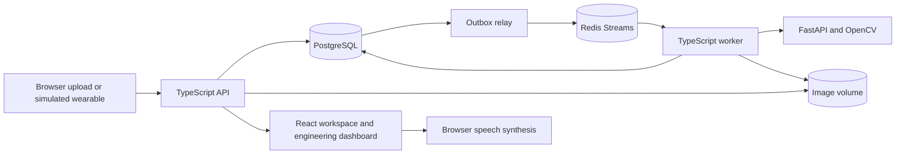

# CueVision 2.0 roadmap

The primary demo uses a browser upload or prerecorded capture to obtain a spoken recommendation and an annotated pool-table image. The original Python engine remains the source of shot advice. Each milestone has a review and a stop before the next milestone begins.

## Architecture



- **FastAPI and OpenCV** preserve the existing engine and give other processes a typed image-in, analysis-out interface. Keep the standalone CLI for diagnostics. Bind the local service to loopback for development and use a private network in Compose.
- **TypeScript API and worker** share one package and one build. The API owns sessions, uploads, history, and status. A separate process runs analysis jobs so clients can disconnect or retry independently of CPU-heavy image processing.
- **PostgreSQL** owns job state, result metadata, attempt counts and timestamps. The queued job row also serves as the durable outbox. A relay publishes job IDs to Redis and tolerates duplicate publication. Recover queued work after broker state loss from durable state. Scope idempotency to a session. An identical retry returns the existing job and a key reused for different inputs returns HTTP 409.
- **Redis Streams** provides worker fan-out and pending-message recovery. Acknowledge only after persisting the result or durable retry. Use bounded attempts, worker timeouts, and lease tokens to prevent an expired worker from overwriting a newer attempt. Retry transient service failures and fail permanent input errors directly. Integration tests must justify the extra broker by exercising recovery, duplicate delivery and concurrent consumers.
- **Shared local volume** holds original images and overlays under server-generated keys. Write via temporary paths and atomic rename, publish only after successful writes, and clean up orphaned files. Serve artifacts through scoped endpoints. Validate format, body size, and decoded dimensions and keep image bytes and session credentials out of routine logs.
- **React** shows job-scoped results and provides browser speech on explicit playback, with text always available. Start with bounded polling of the active job and stop on terminal state. Add SSE if responsiveness or polling overhead warrants it. Keep the local engineering view access-controlled if the application ever leaves local use.
- **Compose and CI** make real service dependencies reproducible. Bind the public demo entry point to loopback by default, keep the data stores internal, and validate startup with migrations and health checks.

## Proposed layout

```text
CueVision/
  pool_ai_full/          Existing vision, planner, CLI and FastAPI service
  tests/analysis/        Python behavior and transport tests
  apps/backend/          TypeScript API, worker, migrations and integration tests
  apps/web/              React workspace, engineering view and browser tests
  integrations/          Replay simulator and a bounded Android spike
  legacy/messenger/      Original scripts and legacy Node manifests, without cookies
  docs/                  Audit, roadmap, contracts and developer setup
  benchmarks/            Workloads, scripts and recorded measurements
  compose.yaml
  .github/workflows/
```

Keep the existing sample path through the baseline and stabilization. When relocating the Messenger code, preserve its attribution and exclude it from modern workspace installs and container builds.

## Service contracts

- Upload one JPEG or PNG per capture with an opaque session credential, a capture source and a session-scoped idempotency key. Keep capture timestamps optional and record server receipt time. A successful submission returns HTTP 202 and a job ID. Jobs transition through queued, processing, completed or failed. Persist attempts and transition timestamps separately.
- A completed analysis distinguishes recommendation, no usable table or cue ball, and no clear direct pot. Return advice, detected count, nullable shot geometry, overlay dimensions and coordinate space, and an artifact reference in the public response. Validate Python's response at the worker boundary and keep raw NumPy types inside the engine.
- Fetch status, artifacts and history within the originating session. Use the active job ID to filter UI updates and speech, even when prior jobs finish later. Keep diagnostic events keyed by request and job IDs without private content.

## Milestones and acceptance

| Milestone | Status | Implementation and acceptance |
| --- | --- | --- |
| 0. Audit and baseline | Completed | Inspected source and Git state, ran the legacy CLI and API against the sample, staged cookie untracking, added ignore rules and a configuration example, and recorded results in the audit. |
| 1. Analysis | Completed | Pinned runtime and test dependencies. Added typed JSON, JPEG/PNG limits, bounded analysis threads, health checks, structured errors and logs, and Windows CLI output handling. The 17-test Windows suite passed and the sample returned HTTP 200 with a 1024×512 PNG over loopback. Linux wheel resolution passed. |
| 2. Backend | Completed | Built the TypeScript API and worker, PostgreSQL migrations, Redis Streams dispatch, and shared artifact storage. Seven tests passed against the real Compose stack, covering scoped results, concurrent idempotency, permanent rejections, retry exhaustion, Redis outage and stream loss, interrupted leases, and replay after completion. See the [backend guide](backend.md). |
| 3. Capture | Completed | The browser capture page supports simulated stills, local images, and ordered frame replay using one session-scoped capture client. Verified all three sources, invalid input and reconnect in Chrome against Compose. The Android SDK review found the required native toolchain absent. See the [capture guide](capture.md) and [grading checklist](grading.md). |
| 4. End to end | Completed | The browser shows job progress, readable advice, original and annotated images, and speech playback. Three Chrome tests passed against Compose, including a late response from an older same-session job. Native Chrome reported a speech-start event. The first [local simulated baseline](../benchmarks/README.md) recorded 564.1 ms median and 580.7 ms P95 from capture click to visible advice. |
| 5. Dashboard | Pending | Refine the responsive dark React workspace and engineering views using real history, attempt timings, queue depth, worker heartbeat, latency and safe diagnostic events. Verify empty, pending, failed, unavailable and complete states. |
| 6. Performance | Pending | Run identical workloads before and after changes. Publish median, P95, throughput, failures and stage timings with runner, concurrency and versions. Report measured results against the approximate 40% improvement and 1.5-second targets, including any shortfall. |
| 7. Reproducibility | Pending | Complete Compose configuration, readiness dependencies, validated environment, migration automation and GitHub Actions. Verify a clean-clone startup and CI unit, real-service integration, build and browser smoke tests. |
| 8. Portfolio review | Pending | Complete README, attribution, architecture and setup instructions. Capture actual screenshots and a demo recording. Complete correctness, security, dependency, test and performance review against the measured system. |

## Wearable scope

Meta documents native Android and iOS photo/video APIs and mock devices. The official changelogs list DAT 1.1.0 on November 20, 2026. Use the Android CameraAccess preview-capture flow for a Windows-compatible Kotlin spike. Its published prerequisites include Android Studio Narwhal, JDK 17 and Android SDK 36. MockDeviceKit supports configured JPEG or PNG capture, HEVC video fixtures, and simulated permission and lifecycle transitions. Verify the selected emulator and dependency access before committing to native delivery. Experimental standalone capture and voice invocation have publishing restrictions. Physical pairing, capture latency and feedback routing require hardware validation. Browser replay remains the primary demo. [Android sample](https://github.com/meta/meta-wearables-dat-android/blob/main/samples/CameraAccess/README.md) · [MockDeviceKit](https://github.com/meta/meta-wearables-dat-android/blob/main/plugins/mwdat-android/skills/mockdevice-testing/SKILL.md) · [Android changelog](https://github.com/meta/meta-wearables-dat-android/blob/main/CHANGELOG.md) · [iOS changelog](https://github.com/meta/meta-wearables-dat-ios/blob/main/CHANGELOG.md)

## Verification strategy

- Python tests cover planner geometry and occlusion, sample rectification, blank and unrectified images, valid JSON and overlay decoding, invalid signature, oversize uploads and readiness.
- Integration runs exercise the real Python service, Redis and PostgreSQL. Use repeatable failure injection for timeouts, replay, worker termination, and exhausted retries. Assert durable result ownership and one logical job per idempotency key.
- Browser tests cover simulated and local capture, progress, history, explicit no-result and failure states, and stale responses. Spy on the speech call in CI and verify audible playback separately in a supported browser.
- Benchmarks use several representative images, warmup, repeated single and concurrent runs, consistent result quality, and pinned configuration. Record capture-to-visible-result and speech start separately. Use monotonic timing for upload, queue wait, analysis and delivery within the component that measures each span. Store commands, workloads, machine details and actual results in `benchmarks/`.

## Prerequisites

Stabilization needs a reproducibly installable Python environment. Real-service integration needs a running Docker Linux engine or equivalent local PostgreSQL and Redis. Native experimentation later needs the Android toolchain and access to Meta's SDK artifacts. The simulated path is independent of those native prerequisites. See the [repository audit](repository-audit.md) for the local baseline.
